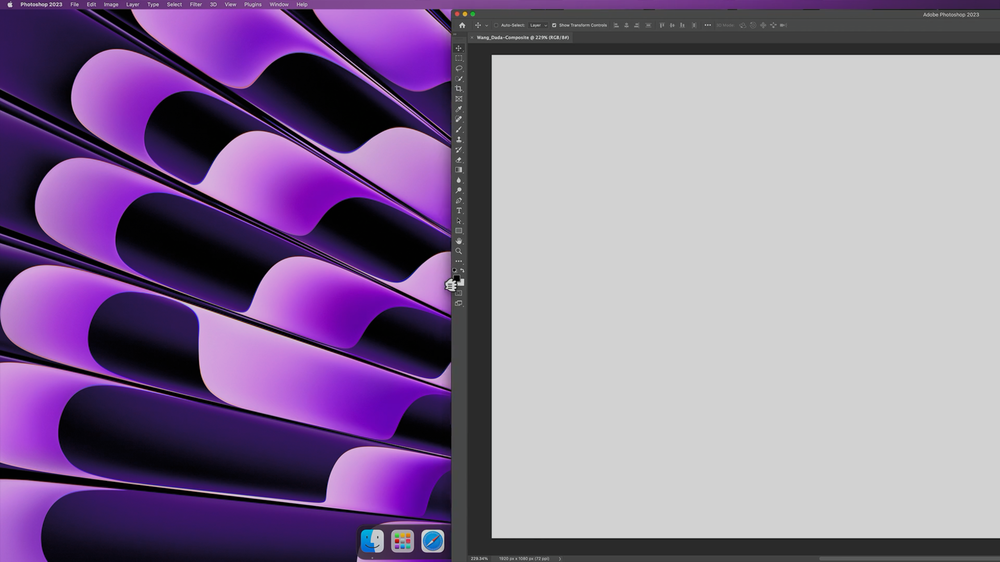
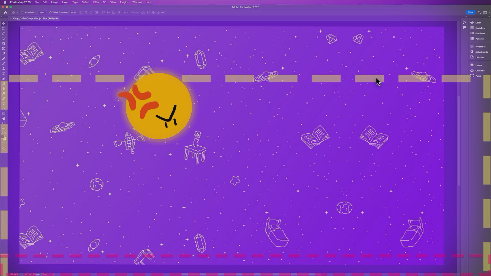
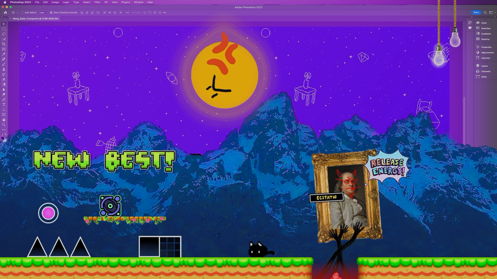
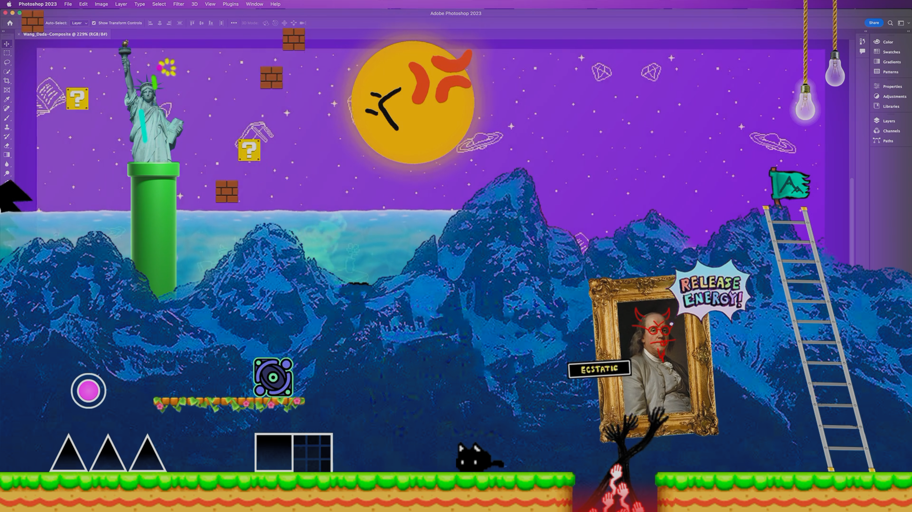
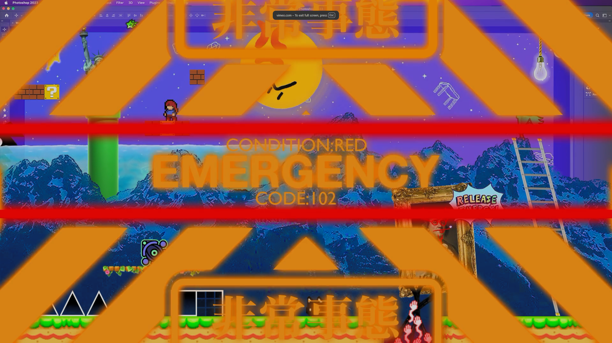
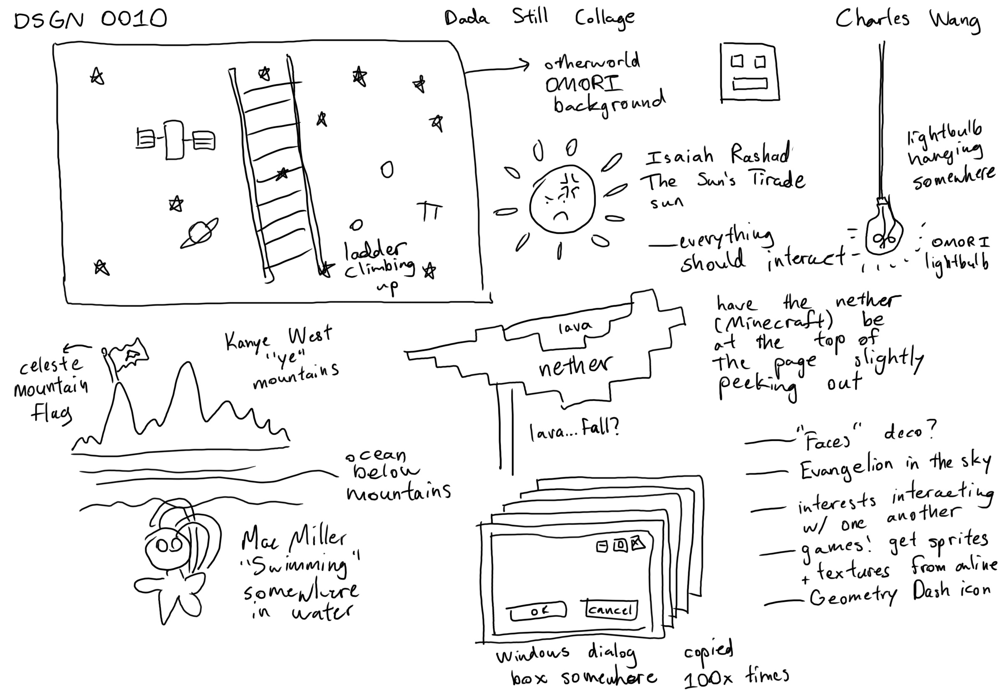

import Vimeo from "@/components/mdx/vimeo.astro";

This was made for Penn's DSGN 0010 course. First, the animation itself. (Turn your sound on as well.)

<figure class="outdent-max">
  <Vimeo id={885330324} />
  <figcaption>
    If the Vimeo embed isn't loading, here's the direct link:
    [vimeo.com/885330324](https://vimeo.com/885330324)
  </figcaption>
</figure>

Here are some still frames from the animation.

     
   

Inspired by Dada and Surrealism, this assignment asked us to assemble a collage and animation of images that resonate with you. Everything that you see in the animation is relevant to me in some way.

Here's the initial sketch of ideas:

