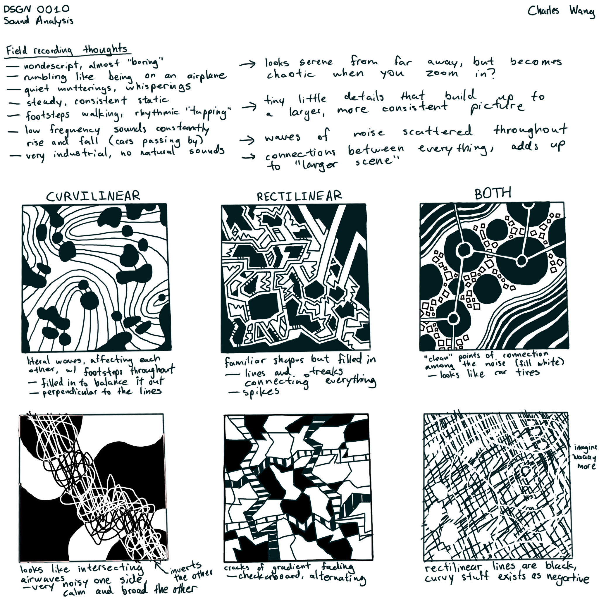
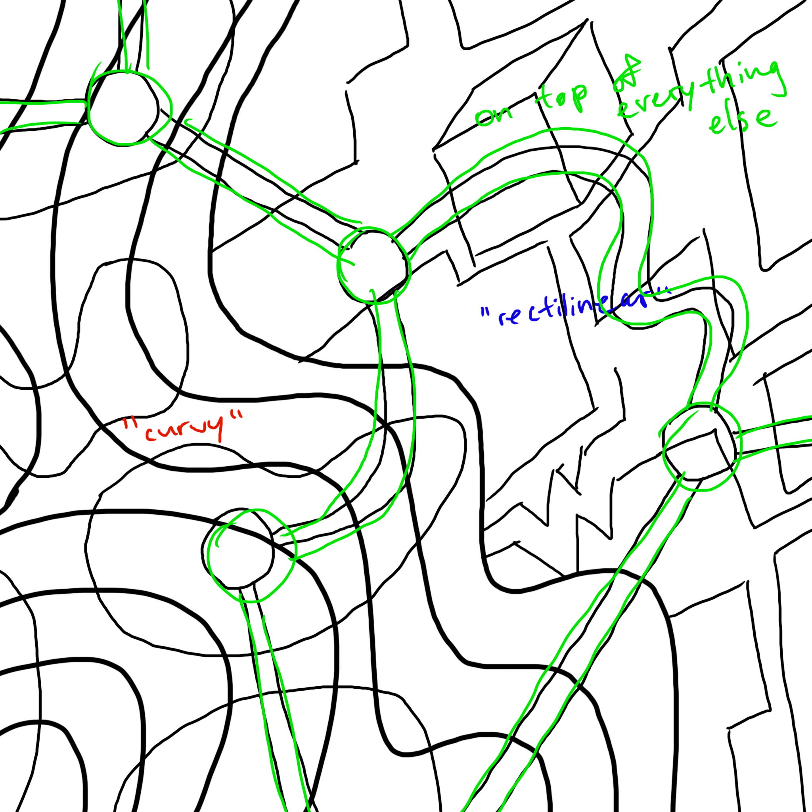
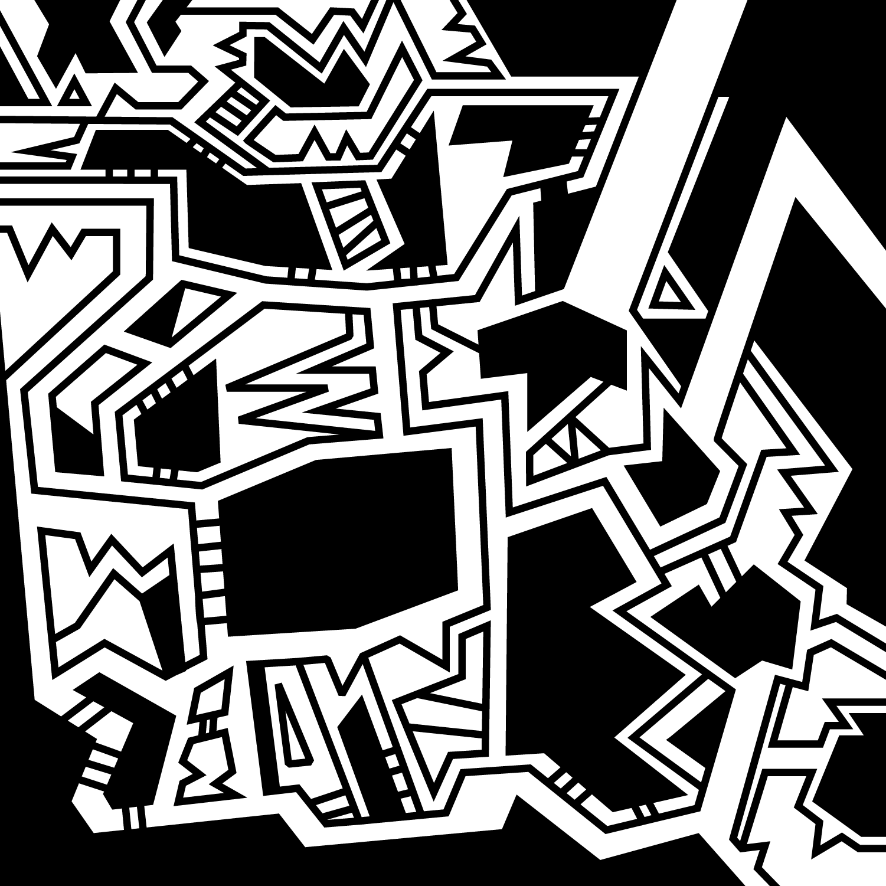
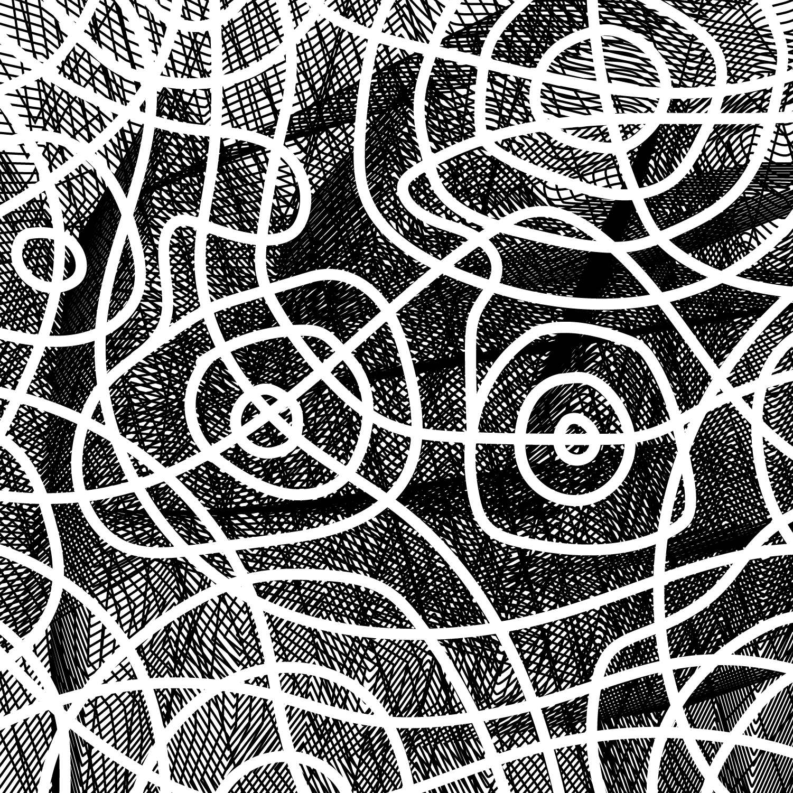

This was made for Penn's DSGN 0010 class. The assignment asked us to capture sounds of 1 minute and develop a series of studies that translate what I hear _sonically_ into a _visual_ representation.

Here are my initial notes and sketches derived from the audio.

 

I created these 3 initial drafts.

    

After a round of feedback, I made the final composition piece that combined all three analyses into one.
