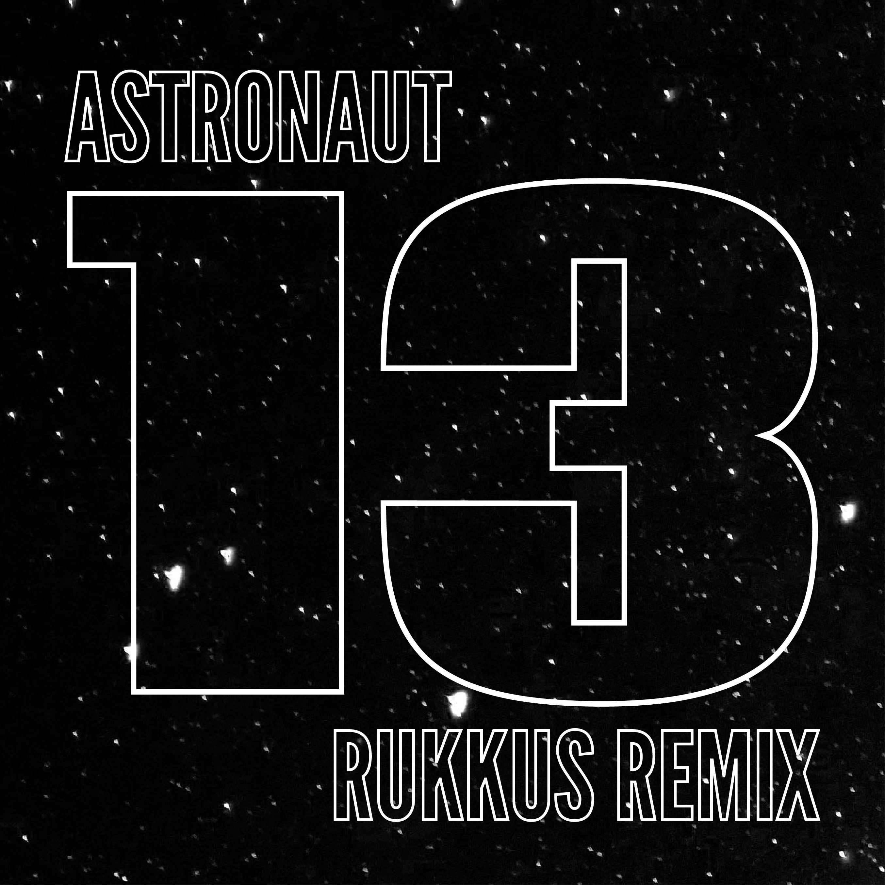

The original artist's name is Astronaut, so I knew I wanted to do something space-related. I chose a blurry picture of the night sky as the background.

My first draft looked like this.

Something felt missing. It felt... too empty, especially the giant "13" in the middle. That's why the final version has those gradients. If you notice, I also repeatedly duplicated and shrunk the background, so it almost feels like you're entering a black hole.
