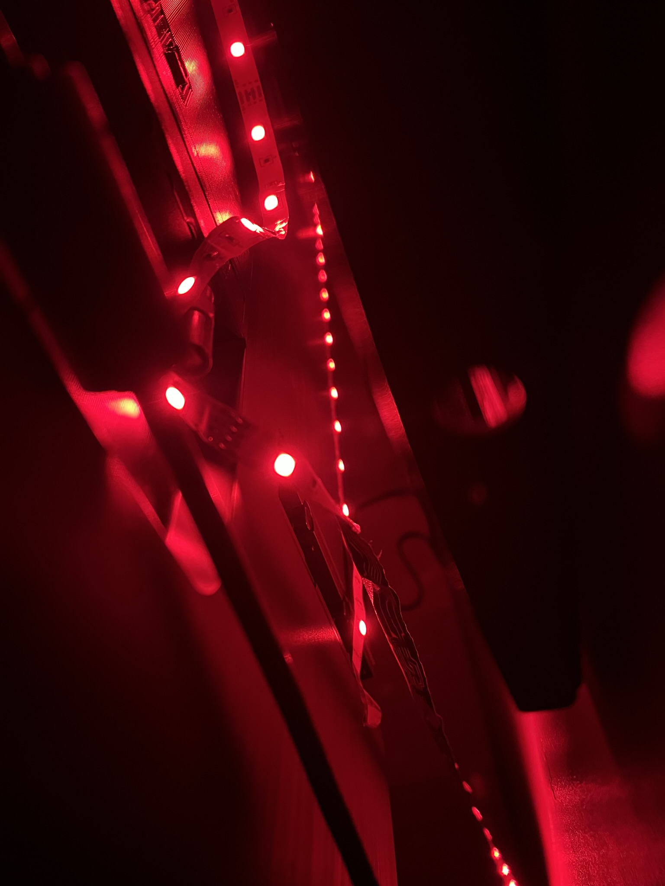
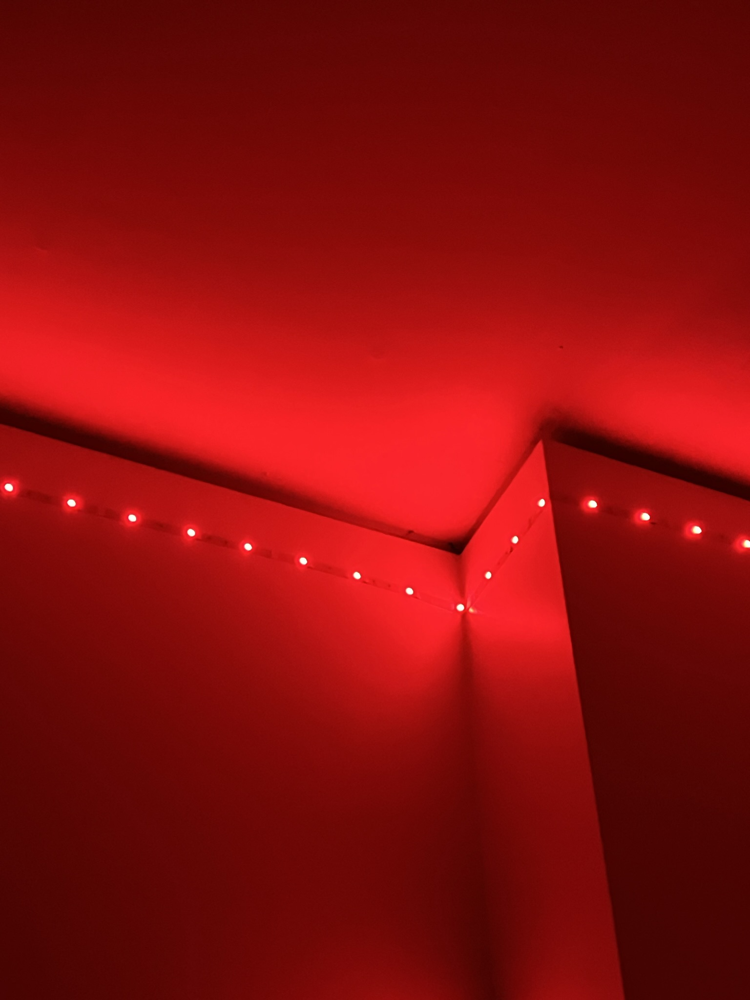
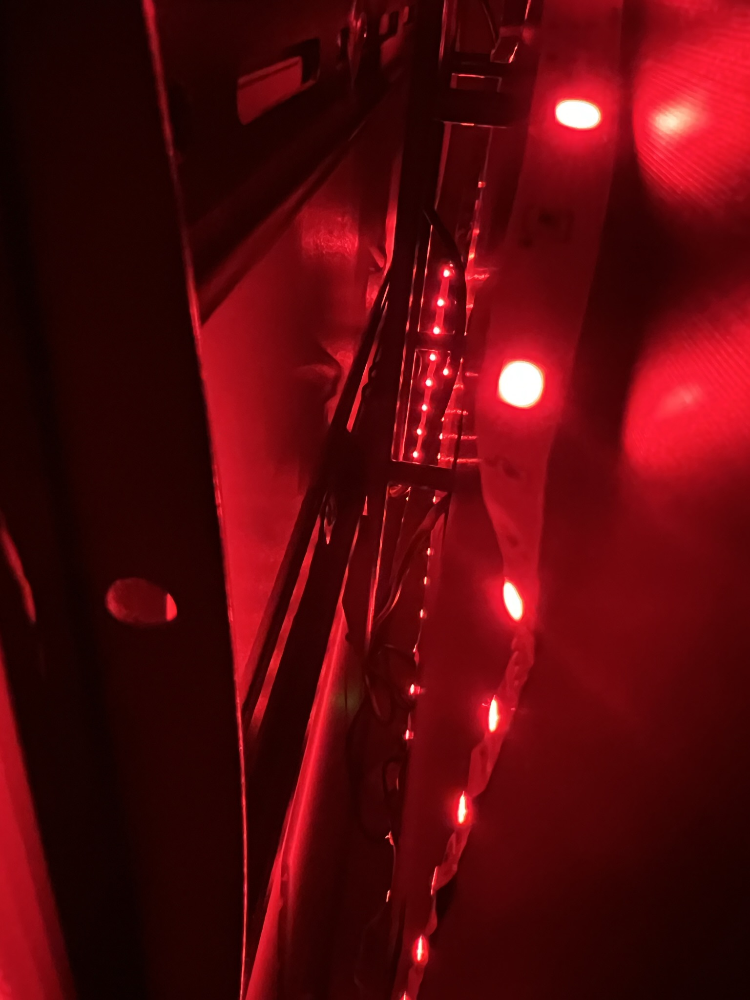
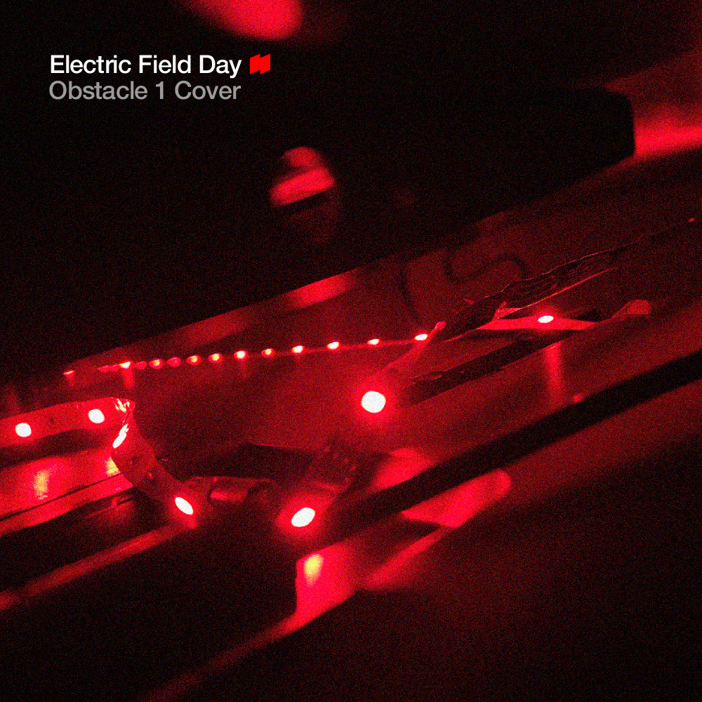
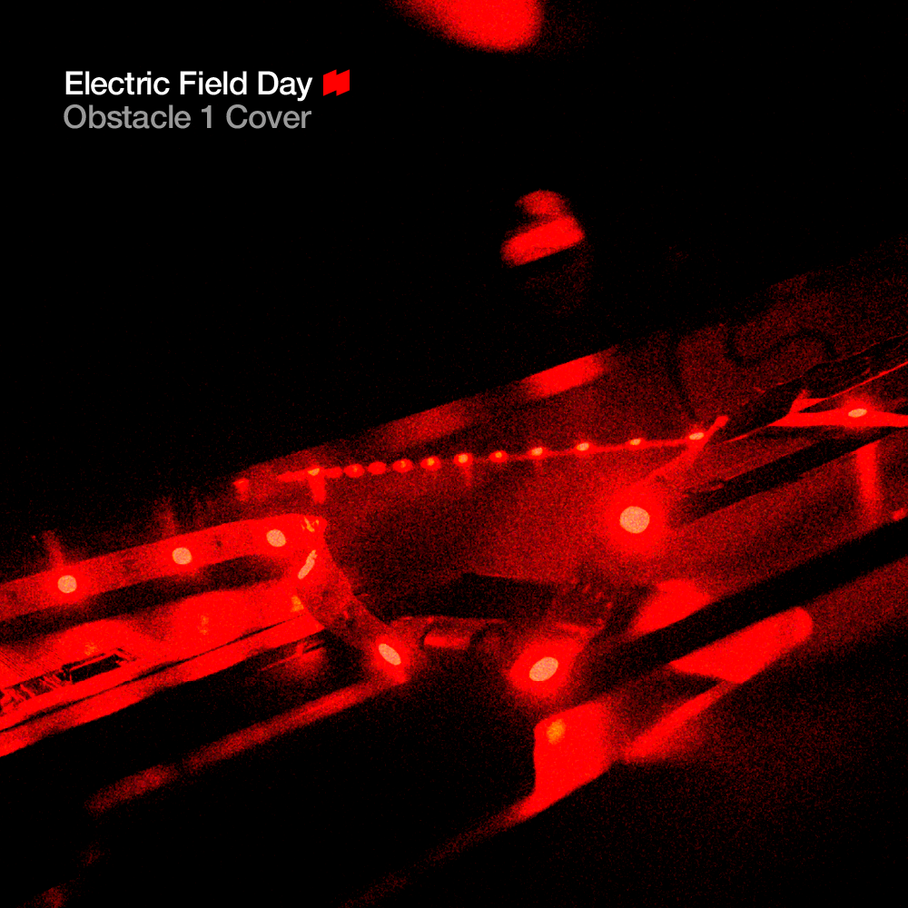
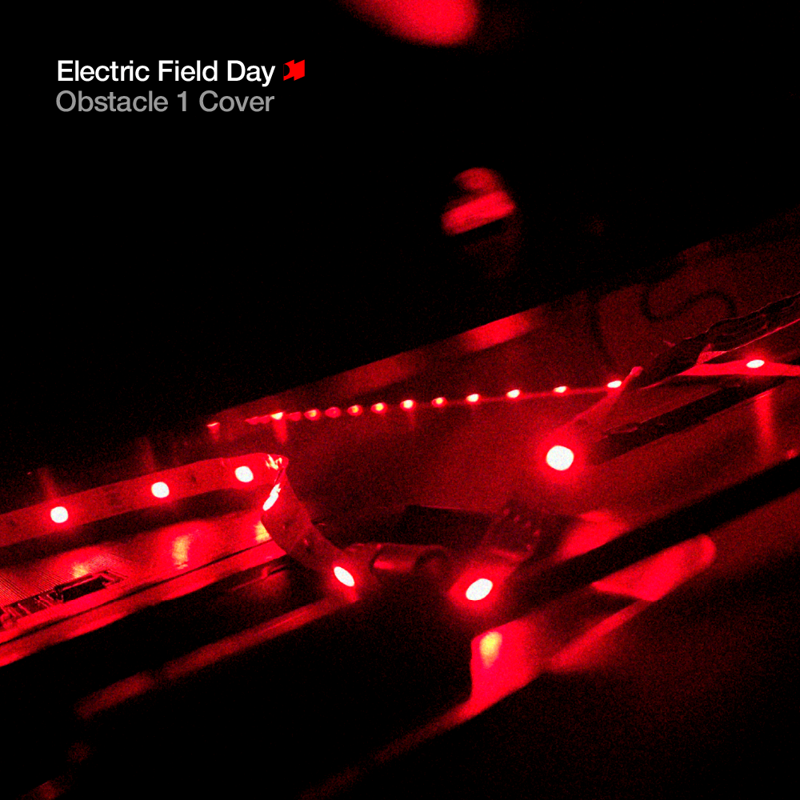
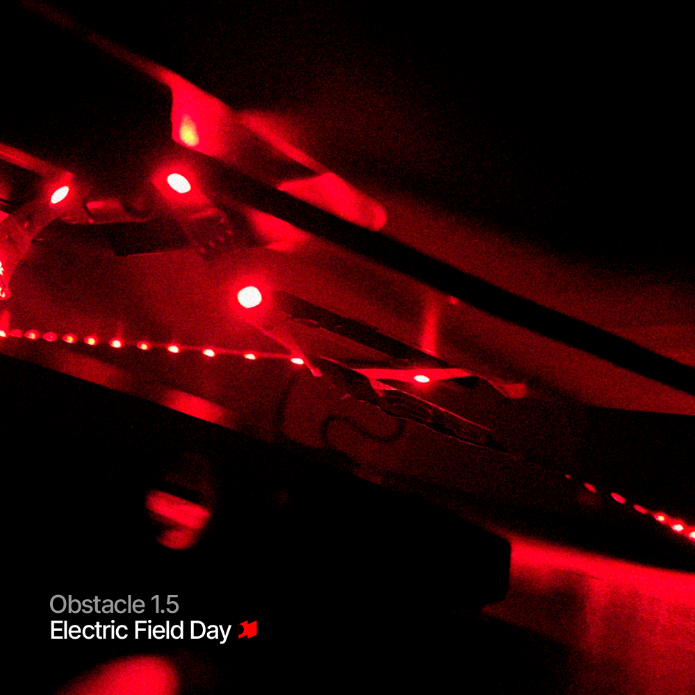

We were interested in covering [Obstacle 1 by Interpol](https://www.youtube.com/watch?v=OC5zHACynR4). Inspired by Turn on the Bright Lights' [album cover](https://duckduckgo.com/?q=turn+off+the+bright+lights+interpol&iar=images), I wanted to do a red and black color scheme and use (what appears to be) Helvetica for the song art.

The dorm room we were in had red LED lights, so I took these photos:

   
 

These 4 are earlier versions, all playing with filters and layout.

     

