When I took over as event organizer of [UPGRADE](https://pennupgrade.com), Penn's game dev club, one of the first things I did was give the branding of the club a complete refresh.

Previously as a member of the club I noticed a lot of inconsistency in terms of how the branding was applied. Now, given this was a student-led, volunteer-based club this was expected, there were more important things to deal with, but I knew this was an opportunity to make our appearance more cohesive and appealing to future potential club members.

<figure class="outdent-max">
  
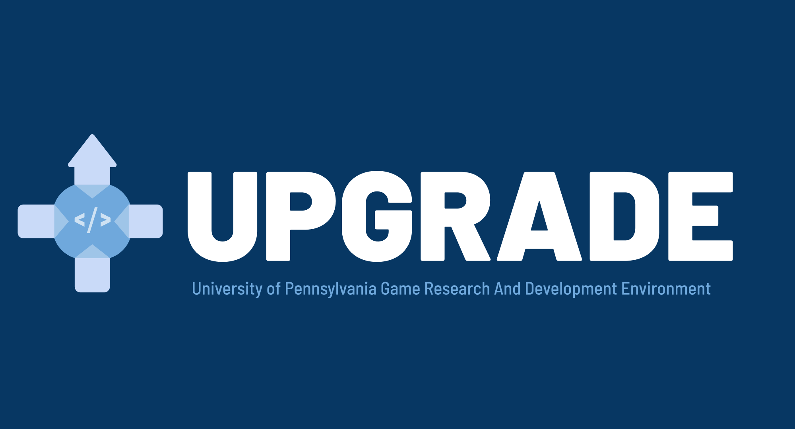 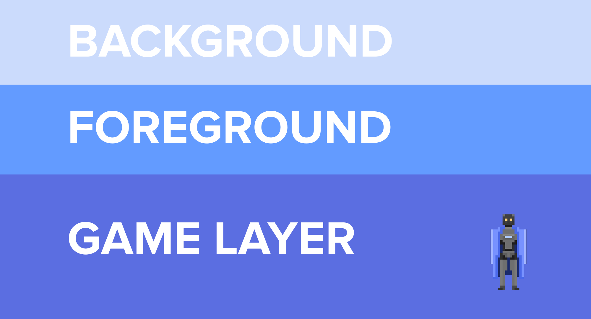 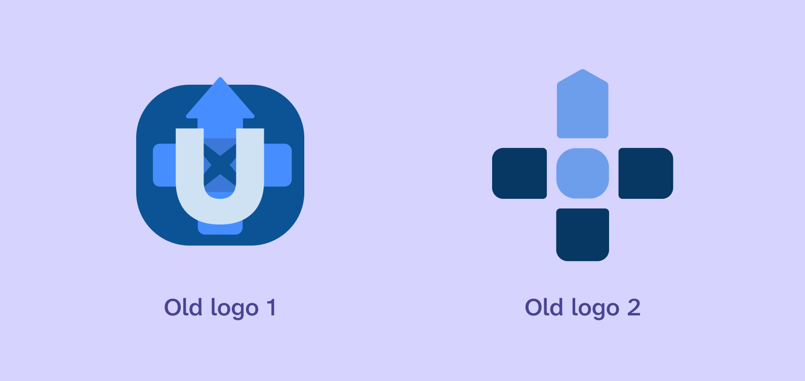

  <figcaption>Examples of the old branding.</figcaption>
</figure>

There were 3 different logos and every hue of blue imaginable being used. This wasn't surprising to me either: as the previous student board stepped down, I'm sure the next one wanted to make some updates of their own.

Well, it was time for me to take up that mantle.[^1]

## Logo

The first step was unifying the previous iterations of the logo into something that would hopefully capture all of their spirits. It consistently revolved around the D-pad, so that's where I started.

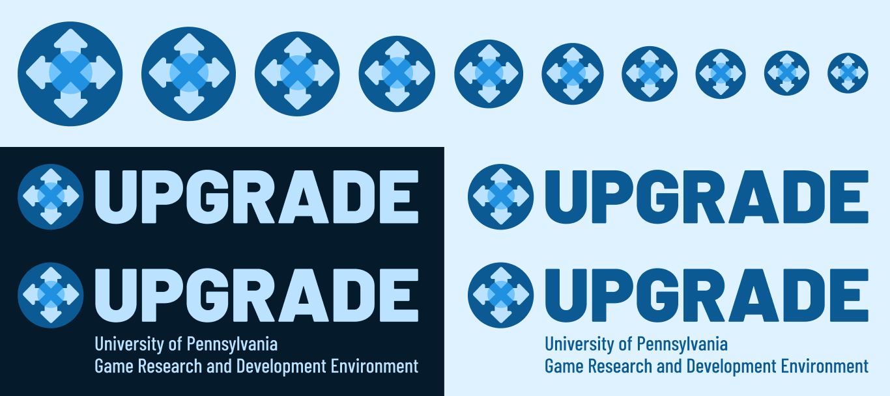

The icon has been cleaned up. It still references the D-pad, but also incorporates the arrows[^2] from the previous logo.

I kept the usage of [Barlow](https://fonts.google.com/specimen/Barlow) as the main font. It's good, it's chunky and it feels both official and a little goofy.

UPGRADE is actually an acronym. It stands for **U**niversity of **P**ennsylvania **G**ame **R**esearch and **D**evelopment **E**nvironment. A little forced, sure, but the resulting name is great and video game adjacent so it fits. I wanted a full logo that would explain this to people.

Finally, I created a dark variant of the logo for light backgrounds. We want to make sure this logo isn't restricted in where it can be used, and I made sure to always export both versions so people had access to both.

### Black and white

For B&W applications the icon would not work because it relies on color to differentiate between all its parts. For this, I created a special version of the icon that keeps the main components and still looks recognizable enough.

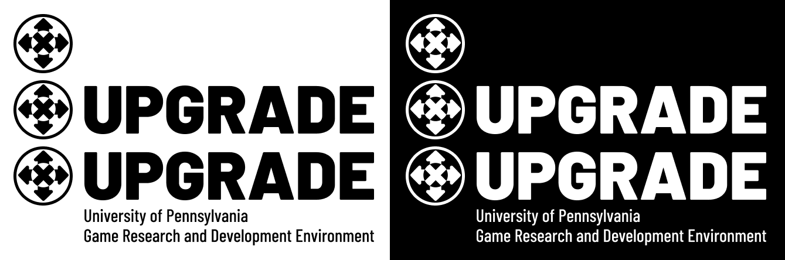

## Palette

Speaking of colors (or the lack thereof), I unified the color palette across 12 swatches so that we should have enough for any scenario.

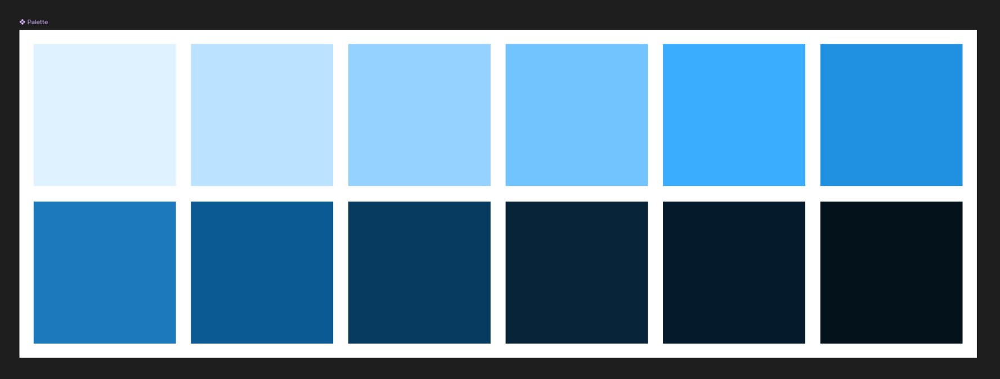

In a world of Penn clubs where everything needs to incorporate or school's American red, white and blue, I wanted to keep the turquoise-looking, navy blue that previous iterations of the club have been using.

I think it really does make the club stand out from the crowd, especially when used consistently and everywhere.

## Arrow motif

The final part of this refresh uses the arrows from the icon as a repeating pattern for backgrounds and such.

  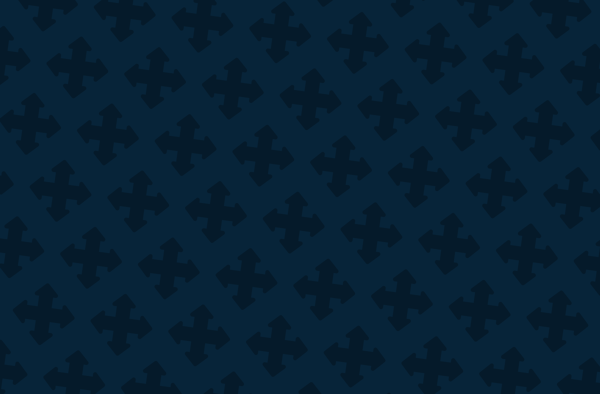 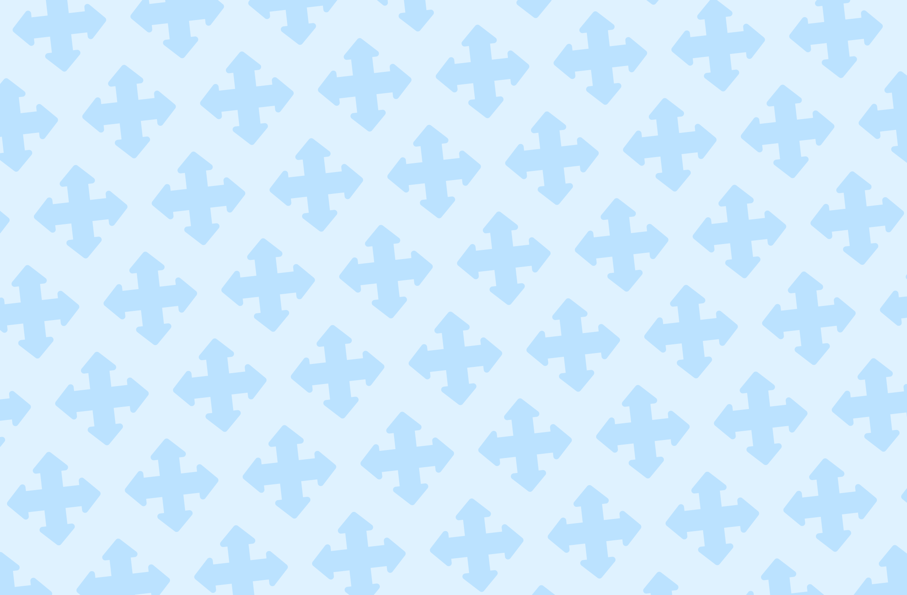

It turns out the arrows make a perfect square when you look at it rotated 45 degrees, which lends to some really good grid-based patterns.

In our games, this background is used during the splash screen on game load. We've also been using it was our background for presentations.

## Applications

With these few branding elements, I was able to create an Instagram account for our club and start broadcasting our online presence. The icon and logo is also used for our Discord server, Google account, itch.io page, and more.

  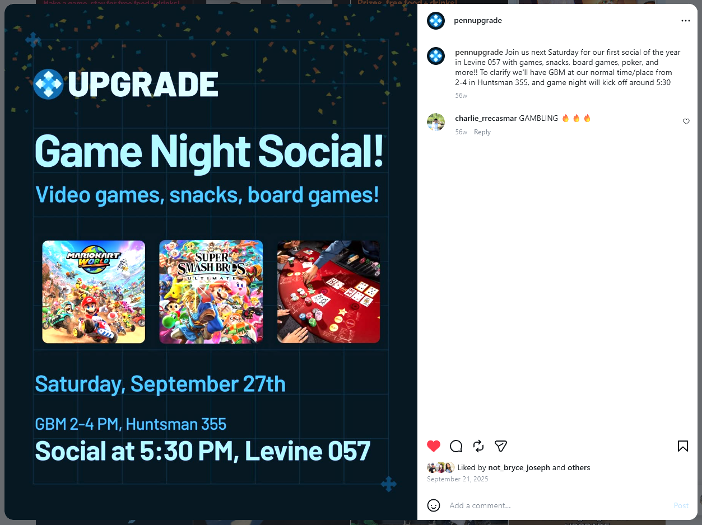 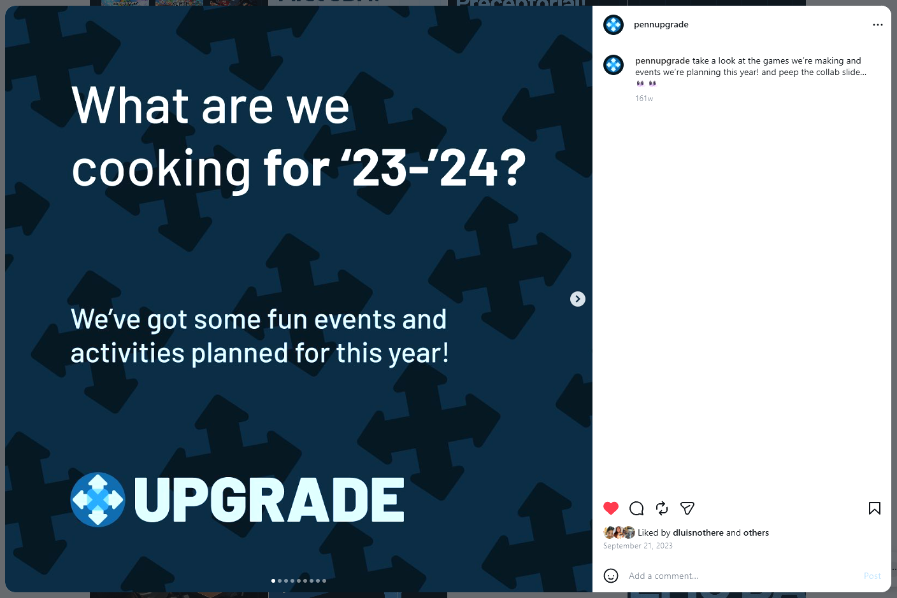 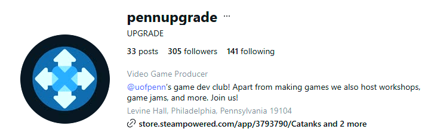 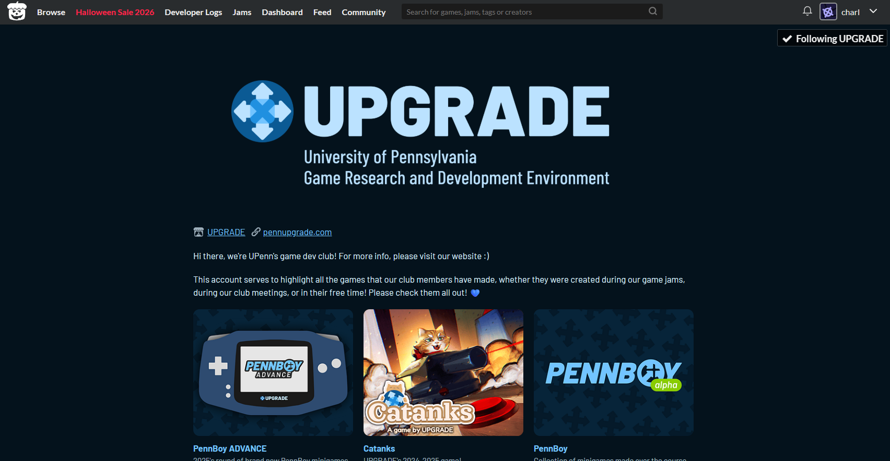

[^1]: The hope is that my refresh is so comprehensive and thorough (and on some level, good-looking) ~~and the future board is lazy enough~~ that mine will last a bit longer than the previous iterations.

[^2]: You could argue the "upgrade" symbolism of having a singular upwards facing arrow has been lost. Now we're not just UPGRADE, but also SIDEGRADE and even DOWNGRADE. But it does lend to a more symmetric and pleasing logo to look at.
