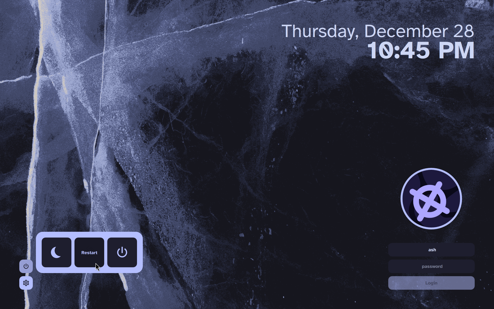
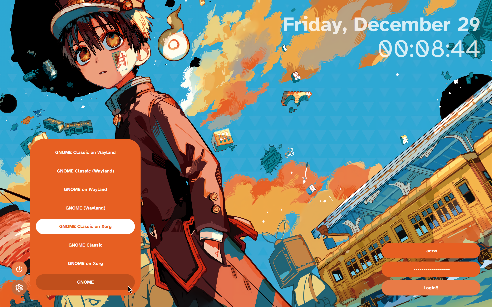
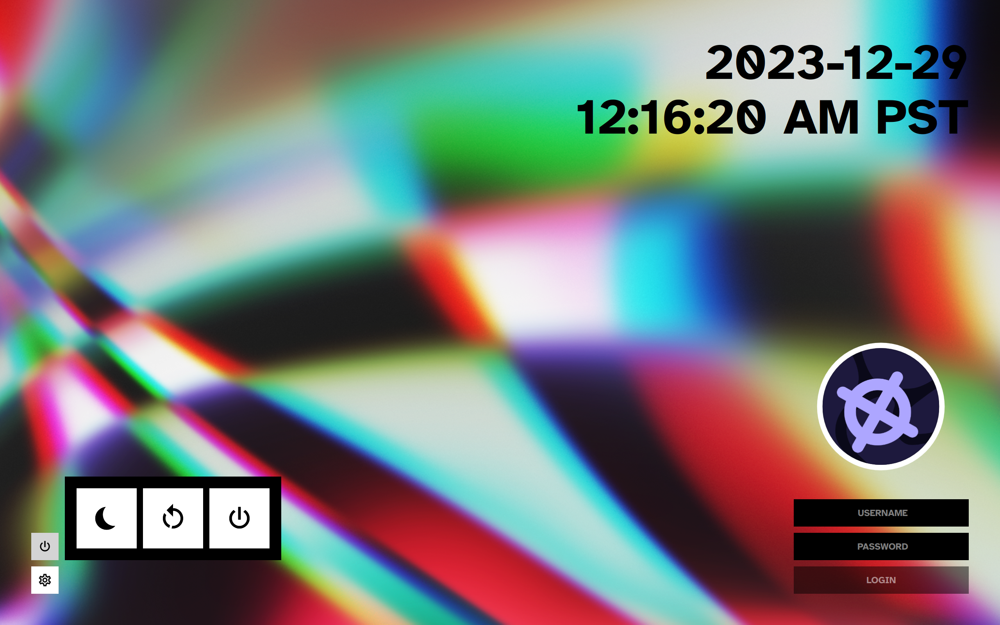
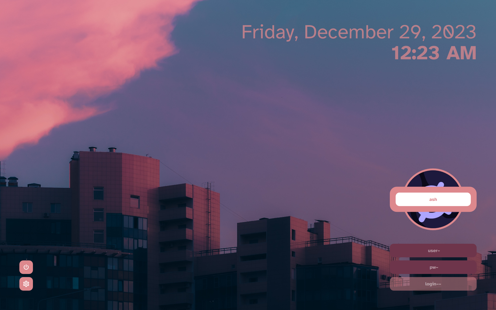

import VideoGif from "@/components/video-gif.astro";

While setting up my Linux environment, I became addicted to customizing my setup and theming _everything_. This is commonly referred to as **ricing** and there are whole [dedicated communities](https://www.reddit.com/r/unixporn) around it.

Having chosen SDDM as my display manager of choice, I started looking for login themes... and didn't find anything that appealed to me. Thus `sddm-theme-corners` was born. Take a look at some example setups:

<div class="outdent-max gallery">
     
</div>

## Designing a login theme

The themes I saw on the [KDE Store](https://store.kde.org/s/KDE%20Store/browse?cat=101&ord=rating) used design elements that I didn't really like. In particular, I wanted something that:

- Focused mainly on the background wallpaper.
- Felt clean and organized.
- Used clear icons and typography.
- Could be customized as much as possible.

This led me to main decision of placing all the elements on the _corners_ of your screen. Interactive UI is anchored to the sides to get out of the way of your background.

Common controls like power and session management are grouped together. Some themes place the session controls below the user field, which made no sense to me because it's not that frequently used. The date and time should easily be legible and are therefore displayed very largely by default.

Some themes included icons for popular DEs like GNOME, KDE, Deepin, etc. I felt that it would be impossible to cover all cases, and chose a text-based list instead. Icons for sessions don't offer enough detail anyway; what if I wanted GNOME on both Xorg and Wayland?

<div class="outdent-wide">
  <VideoGif
    content={{ collection: "projects", folder: "sddm-theme-corners" }}
    name="power-session-buttons"
  />
</div>

The user picture (if you choose to enable it) also acts as a user switcher. All it really does is prefill in the user field. The last user logged in is saved, however, and filled in for you next time.

<div class="outdent-wide">
  <VideoGif
    content={{ collection: "projects", folder: "sddm-theme-corners" }}
    name="user-picture-inputs"
  />
</div>

The login button is grayed out until both input fields are filled out.[^1]

Tying everything together are subtle animations that occur when popups come in and out of view. I especially like what happens when you enter an incorrect login:

<div class="outdent-wide">
  <VideoGif
    content={{ collection: "projects", folder: "sddm-theme-corners" }}
    name="incorrect-login-anim"
  />
</div>

Don't like the default colors or how round everything is? I've exposed multiple config options that allow you to theme pretty much everything. You can also change the font and datetime format; however, the layout itself cannot be modified. After all, stuff in `sddm-theme-corners` should stay in the corners!

## Learning Qt Quick and QML

Building the login theme was the most difficult part of the process. I had no prior experience with QML; this was my first time learning about the existence of Qt!

To get started, I looked through the default themes that SDDM provides, as well as user-made themes. By looking through their code, I learned that `Main.qml` is the main entry file for SDDM. I discovered the existence of `theme.conf` and how to support customization options in my own code. I saw real, working examples of QML syntax, including utilizing a QML object's `id` attribute and adding custom properties.

I definitely committed some coding sins while trying to figure out how to hook everything together. I'm particularly proud of this abomination:[^2]

```js
Component.onCompleted: {
  if (userPicture.enabled) {
    userPicture.source = userWrapper.items.get(userList.currentIndex).model.icon;
  }
}
```

## Try it out!

Follow the README in the GitHub repo for setup instructions. I've been using it everyday with no complaints.[^3]

While SDDM is best known for being KDE's display manager, it actually works for any desktop environment. So this does as well! If you're on Linux and like what you see, do test it out and lemme know what you think.

Happy ricing! 🍚

[^1]: Am I assuming that every user has a password? Yes, yes I am.

[^2]: I revisited this line for the write-up, and... I'm not too sure what it does. I think it updates the picture displayed when you switch users.

[^3]: I might be biased, though.
